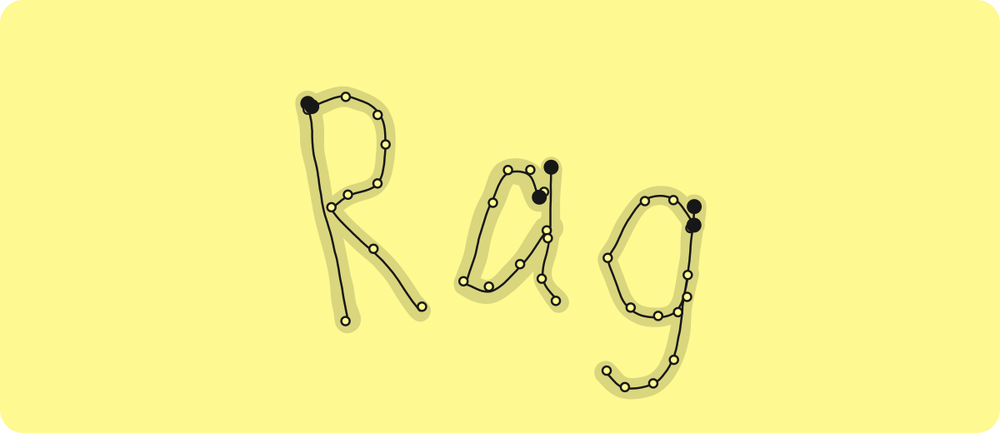
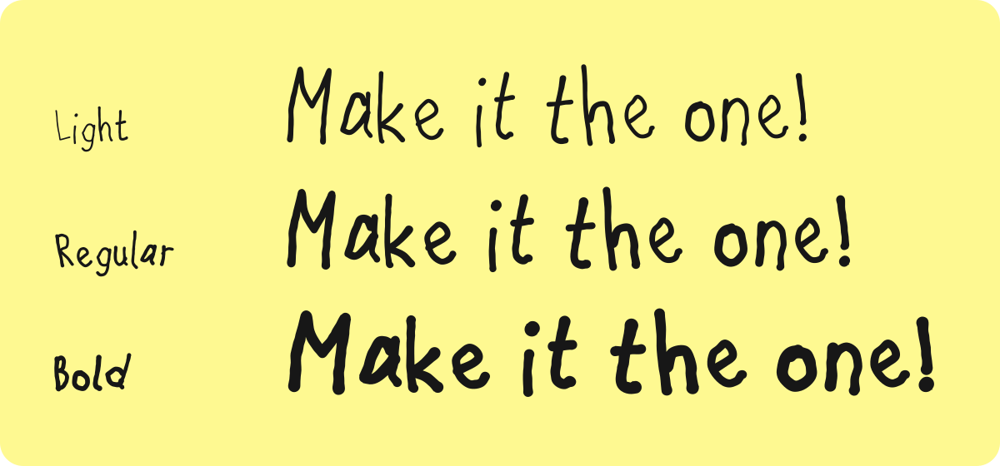
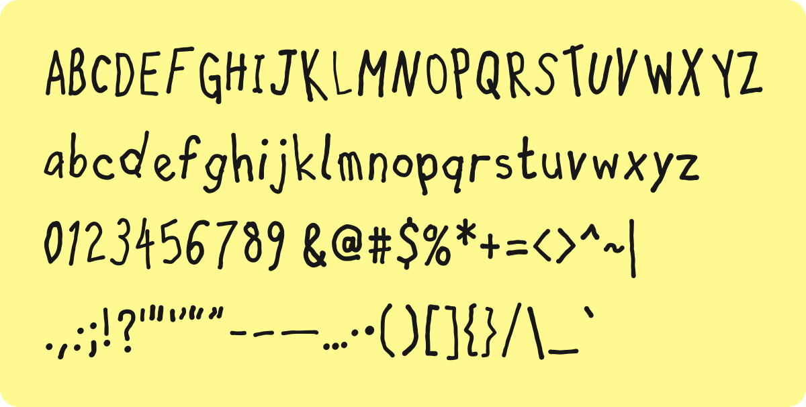
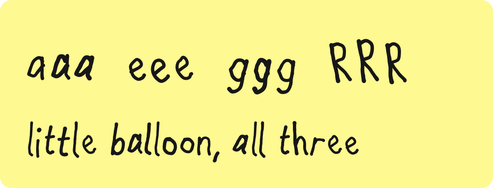

# Wiggle Wiggle

A graffiti marker font that never holds still. Each character is written three times by a shaky hand, and the line can boil at 12 frames per second, like the hand-drawn animation in the *Spider-Verse* films.

Wiggle Wiggle is the house typeface of [z1han.com](https://z1han.com). It is free and open source under the [SIL Open Font License 1.1](OFL.txt).

**[Download the latest release](https://github.com/bravohenry/wiggle-wiggle/releases/latest)**, or try every weight and character at [z1han.com/font](https://z1han.com/font).

## Written, not drawn



Each glyph starts as a skeleton: centerlines in the order a hand writes them. A felt-tip nib sweeps along each line. It adds tremor, uneven pressure, blunt ink knobs at the stroke ends and a small hook where the pen lifts. The font knows its stroke order, so it can write itself.



The thin line is the path of the pen tip. Hollow dots are skeleton points. Solid dots show where each stroke starts.

## Three weights



One skeleton, three pens. Light is a fine marker and Bold is a fat one. Bold widens narrow letters so that their counters stay open.

| Style | Weight | Desktop | Web |
|---|---|---|---|
| Light | 300 | `WiggleWiggle-Light.otf` | `WiggleWiggle-Light.woff2` |
| Regular | 400 | `WiggleWiggle-Regular.otf` | `WiggleWiggle-Regular.woff2` |
| Bold | 700 | `WiggleWiggle-Bold.otf` | `WiggleWiggle-Bold.woff2` |

## Character set



Basic Latin (all of ASCII), plus curly quotes, en and em dashes, ellipsis, middle dot and bullet: 103 characters, 309 glyphs.

## No two letters alike



Each character has three alternates. Contextual alternates (`calt`, on by default) rotate through them, so the two l's in *balloon* never match. This works in any app that supports OpenType.

## Make it boil

Two stylistic sets hold the other two frames of the boil:

| Feature | Effect |
|---|---|
| `calt` | Rotates the three alternates. On by default. |
| `ss01` | Boil frame 2. Moves every glyph to its next alternate. |
| `ss02` | Boil frame 3. Moves every glyph two alternates on. |

To animate a line, stack three copies and show one at a time, 12 times per second. This is how z1han.com animates its wordmark:

```html
<span class="boil">
  <span>Make it the one</span>
  <span aria-hidden="true">Make it the one</span>
  <span aria-hidden="true">Make it the one</span>
</span>
```

```css
.boil { display: inline-grid; font-family: "Wiggle Wiggle"; }
.boil > * { grid-area: 1 / 1; }
.boil > :nth-child(2) { font-feature-settings: "ss01"; opacity: 0; }
.boil > :nth-child(3) { font-feature-settings: "ss02"; opacity: 0; }

@media (prefers-reduced-motion: no-preference) {
  .boil > * { animation: boil 250ms step-end infinite; }
  /* Offset by half a frame so that two copies never show together */
  .boil > :nth-child(1) { animation-delay: -41.7ms; }
  .boil > :nth-child(2) { animation-delay: -208.3ms; }
  .boil > :nth-child(3) { animation-delay: -125ms; }
}

@keyframes boil {
  0% { opacity: 1; }
  33.333%, 100% { opacity: 0; }
}
```

## Use on the web

Load the WOFF2 files from this repository through jsDelivr, or copy them from [`fonts/woff2`](fonts/woff2) into your project:

```css
@font-face {
  font-family: "Wiggle Wiggle";
  src: url("https://cdn.jsdelivr.net/gh/bravohenry/wiggle-wiggle@v1.000/fonts/woff2/WiggleWiggle-Light.woff2") format("woff2");
  font-weight: 300;
  font-display: swap;
}
@font-face {
  font-family: "Wiggle Wiggle";
  src: url("https://cdn.jsdelivr.net/gh/bravohenry/wiggle-wiggle@v1.000/fonts/woff2/WiggleWiggle-Regular.woff2") format("woff2");
  font-weight: 400;
  font-display: swap;
}
@font-face {
  font-family: "Wiggle Wiggle";
  src: url("https://cdn.jsdelivr.net/gh/bravohenry/wiggle-wiggle@v1.000/fonts/woff2/WiggleWiggle-Bold.woff2") format("woff2");
  font-weight: 700;
  font-display: swap;
}
```

For desktop apps, install the OTF files from [`fonts/otf`](fonts/otf) or from the [latest release](https://github.com/bravohenry/wiggle-wiggle/releases/latest).

## How it is made

Nobody drew the outlines. Five Python scripts in [`sources`](sources) generate the font:

| File | Job |
|---|---|
| `glyphs.py` | The design source. Centerlines for each character in writing order, plus a pose for each letter (lean, height, baseline shift). |
| `pen.py` | The felt-tip nib. Sweeps each centerline with tremor and pressure, joins the shapes with skia-pathops and fits cubic curves. |
| `build.py` | Three pens, three seeded alternates per glyph, the `calt`, `ss01` and `ss02` features, OTF and WOFF2 output. |
| `lettering.py` | Exports stroke-by-stroke writing data for any word. The Notes heading on z1han.com uses it. |
| `specimen.py` | Renders the images in this README from the glyph outlines. |

The random seeds come from glyph names, so the same source always builds byte-identical fonts. To rebuild, install [uv](https://docs.astral.sh/uv/) and run:

```bash
uv run sources/build.py --out fonts/woff2 --otf fonts/otf --specimen images
```

The scripts declare their own dependencies, so you need no other setup. The comments in the source are in Chinese.

The font is designed in the private repository of z1han.com and mirrored here. Issues and ideas are welcome.

## License

Copyright 2026 [Zihan Huang](https://z1han.com). Licensed under the [SIL Open Font License 1.1](OFL.txt).

You can use the font in any project, personal or commercial. You can change it and share it. You cannot sell the font files on their own.
